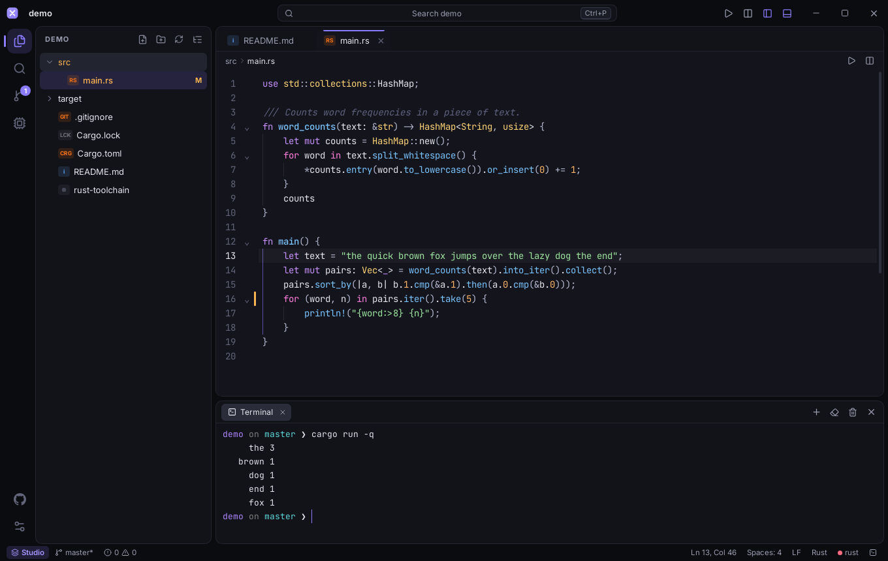
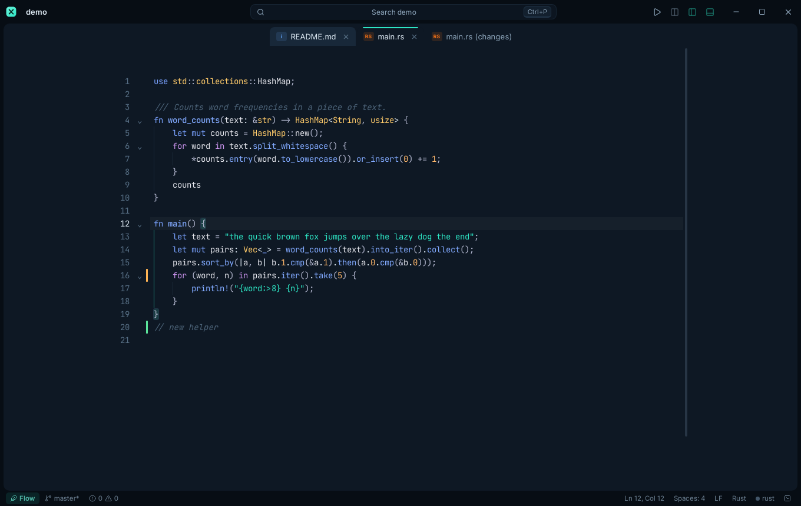
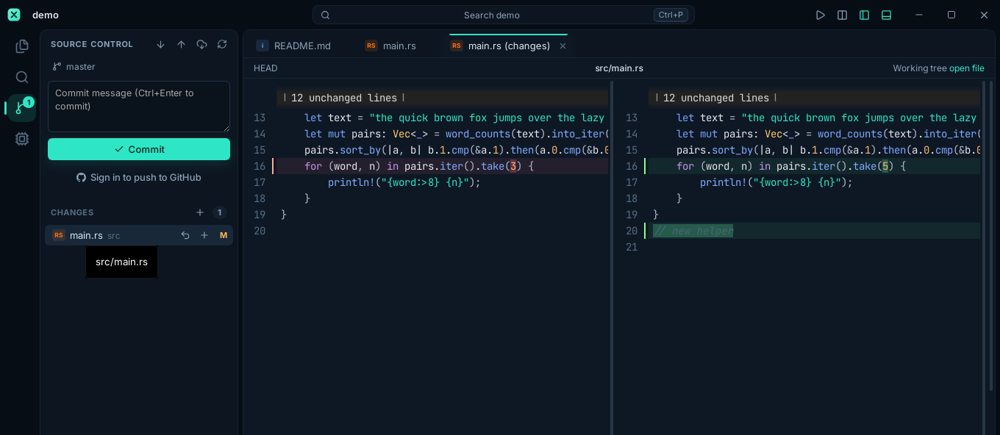
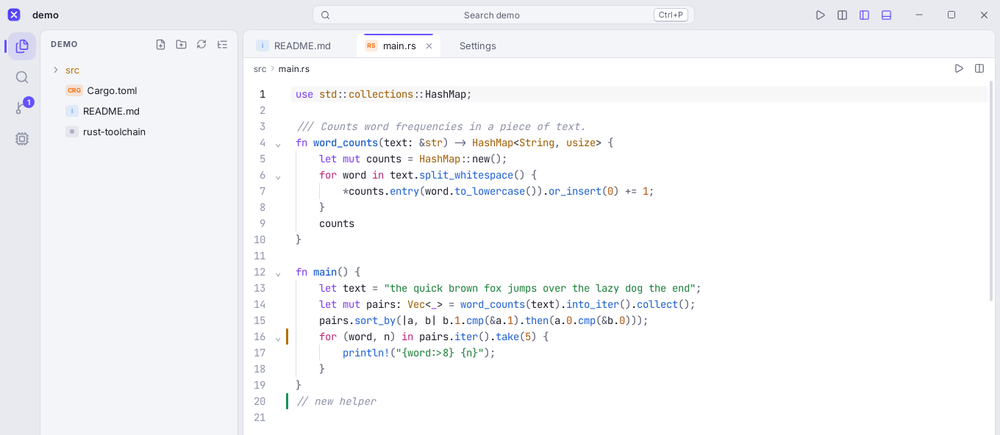
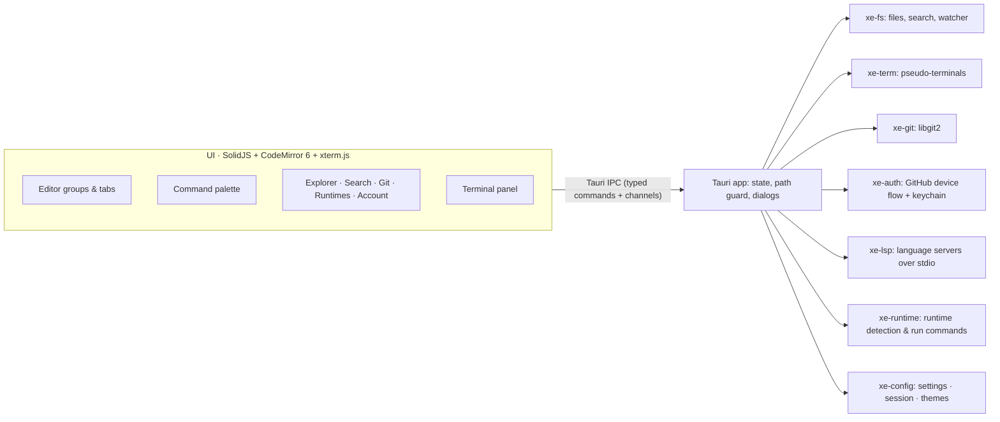

# X-EDITOR

**Write in Flow. Build in Studio.** A fast, good-looking code editor that grows into an IDE when
you need one, and gets out of the way when you don't.



> **Status:** version 0.2.0, an early release. The editor, terminal, Git, search, themes and
> Run commands work today. GitHub sign-in needs a one-time setup (see
> [Enabling GitHub sign-in](#enabling-github-sign-in)). Planned features are listed in the
> [roadmap](docs/ROADMAP.md) and are not shown in the app until they work.

## CONTENTS

- [Why X-Editor](#why-x-editor)
- [Features](#features)
- [Keyboard shortcuts](#keyboard-shortcuts)
- [How it works](#how-it-works)
- [Project structure](#project-structure)
- [Tech stack](#tech-stack)
- [Getting started](#getting-started)
- [Customising](#customising)
- [Development](#development)
- [Documentation](#documentation)
- [License](#license)

## WHY X-EDITOR

Most editors make you choose: a light text editor that can't run your project, or a heavy IDE
that takes seconds to open and lots of memory. X-Editor is both, with one key press between them.

| | **Flow mode** | **Studio mode** |
|---|---|---|
| For | Writing, reading, reviewing, notes | Building, running, debugging, shipping |
| You see | A centred, distraction-free editor | Explorer, search, Git, runtimes, terminal |
| Switch | `Ctrl+Alt+M` (`Cmd+Alt+M` on macOS) or click the mode pill | Same |



### What it does differently

- **Fast and small.** Rust does the heavy work (file search, Git, terminals, file watching) on
  background threads. The UI uses SolidJS, which has no virtual DOM, and CodeMirror 6, which
  only renders what's on screen. A release build is about 8 MB compressed; Electron-based
  editors are well over 100 MB.
- **Knows your runtimes.** X-Editor reads the versions a project asks for (`.nvmrc`,
  `.node-version`, `.python-version`, `rust-toolchain(.toml)`, `go.mod`, `.tool-versions`,
  `mise.toml`, `engines` in `package.json`, `requires-python` in `pyproject.toml`), compares
  them with what's installed, and tells you when they don't match.
- **Run anything with F5.** It compiles into a temp folder (never next to your source), quotes
  paths correctly for bash, zsh and PowerShell, and runs the result in a real terminal.
  `Shift+F5` runs the whole project.
- **Customisable all the way down.** Themes, accent colour, density, corner roundness, fonts,
  ligatures, line numbers, autosave and every shortcut. Changes apply instantly, with no reload.
- **Nothing fake.** Every button does what it says. There are no placeholder panels or mock data.
- **Safe by default.** File access is limited to the open folder and files you pick in a native
  dialog. Saves are atomic, so a crash never leaves a half-written file. Deletes go to the system
  trash, and your GitHub token is kept in the OS keychain.

## FEATURES

### Editing
- CodeMirror 6 with multi-cursor, rectangular selection, bracket matching, auto-close, folding,
  indent guides, find and replace with regex, a smooth cursor, and relative line numbers
- Syntax highlighting for 100+ languages, each loaded only when you open a file that needs it
- Every tab keeps a live editor, so undo history and scroll position survive tab switches
- Split view with drag-and-drop tabs, breadcrumbs, and a Markdown live preview
- Unsaved-changes prompts, optional autosave, trims trailing whitespace on request, and keeps
  Windows (CRLF) line endings
- Files changed outside the app reload automatically, or ask first if you have unsaved edits

### Code intelligence (LSP)
- Autocomplete, hover docs, signature help, go to definition, find references, rename,
  formatting and inline errors
- Works with the language servers you already use: `typescript-language-server`,
  `rust-analyzer`, `pyright`, `clangd` and `gopls` are set up out of the box, and any other
  server can be added in settings
- If a server is missing, X-Editor offers to run its install command in the terminal

### Run and terminal
- Real pseudo-terminals (ConPTY on Windows), so colours, prompts, `Ctrl+C`, `vim`, `htop` and
  interactive programs all work
- Multiple terminal tabs, GPU rendering and clickable links
- **Run File (F5):** Python, JavaScript/TypeScript, C, C++, Rust, Go, Java, Kotlin, Ruby, PHP,
  Lua, Perl, Dart, Swift, shell, PowerShell, R, Julia, Elixir, Haskell
- **Run Project (Shift+F5):** detects Cargo, npm/pnpm/yarn/bun scripts, Go modules, Django,
  `main.py`, Maven, Gradle, .NET and Makefiles

### Git and GitHub
- Status, stage, unstage, discard (to the trash), commit, push, pull, fetch, and switch or
  create branches
- Side-by-side diffs, and change markers next to lines as you type
- Pull only fast-forwards, so nothing is merged behind your back
- Sign in with GitHub through the device flow (no password goes through the app), browse your
  repositories and clone them in one click; push and pull then use your account



### Navigation and search
- One palette for everything: `Ctrl+P` finds files with fuzzy matching, typing `>` runs any
  command, typing `:` jumps to a line
- Workspace search runs in parallel, respects `.gitignore`, supports case, whole-word and regex
  options, and can replace across files
- File explorer with create, rename, delete-to-trash, copy path, open in terminal and Git
  status colours

### Comfort
- Restores your open tabs and layout for each folder
- Five built-in themes (Midnight, Obsidian, Aurora, Ember, Paper) plus your own
- Interface zoom, full screen, and a sidebar on either side



## KEYBOARD SHORTCUTS

On macOS, use `Cmd` wherever `Ctrl` is shown, except for `Ctrl+G`, `Ctrl+Tab` and the terminal
shortcuts, which stay on `Ctrl`. Every shortcut can be changed in **Keyboard Shortcuts** (`Ctrl+K`).

| Action | Shortcut |
|---|---|
| All commands | `Ctrl+Shift+P` |
| Go to file | `Ctrl+P` |
| Go to line | `Ctrl+G` |
| Flow / Studio mode | `Ctrl+Alt+M` |
| Run file / run project | `F5` / `Shift+F5` |
| Toggle terminal / new terminal | ``Ctrl+` `` / ``Ctrl+Shift+` `` |
| Save / save as / save all | `Ctrl+S` / `Ctrl+Shift+S` / `Ctrl+Alt+S` |
| New file / open file / open folder | `Ctrl+N` / `Ctrl+O` / `Ctrl+Shift+O` |
| Open recent folder | `Ctrl+Alt+O` |
| Close tab / reopen closed tab | `Ctrl+W` / `Ctrl+Shift+T` |
| Next / previous tab | `Ctrl+Tab` / `Ctrl+Shift+Tab` |
| Split editor / focus left or right | `Ctrl+\` / `Ctrl+1`, `Ctrl+2` |
| Explorer / search / source control | `Ctrl+Shift+E` / `Ctrl+Shift+F` / `Ctrl+Shift+G` |
| Toggle sidebar / toggle panel | `Ctrl+B` / `Ctrl+J` |
| Format document / toggle word wrap | `Shift+Alt+F` / `Alt+Z` |
| Markdown preview | `Ctrl+Shift+V` |
| Settings / shortcuts / theme | `Ctrl+,` / `Ctrl+K` / `Ctrl+Alt+T` |
| Zoom in / out / reset | `Ctrl+=` / `Ctrl+-` / `Ctrl+0` |
| Full screen | `F11` |

## HOW IT WORKS



The interface never touches the disk or network directly. It calls 49 typed Rust commands, and
every path is checked against the open folder before anything is read or written. File and
folder pickers run in Rust, so the interface can't ask for an arbitrary path. Terminal output and
language-server messages stream over Tauri channels, so fast output stays smooth.

| Crate | Job |
|---|---|
| `xe-fs` | Path guard, atomic saves, trash deletes, `.gitignore`-aware listing and parallel search, file watcher |
| `xe-term` | Pseudo-terminal sessions with UTF-8-safe streaming |
| `xe-git` | libgit2 status, staging, commits, branches, gutter diffs, clone / fetch / pull / push |
| `xe-auth` | GitHub OAuth device flow, user and repository API, keychain storage |
| `xe-lsp` | Starts language servers and relays their JSON-RPC messages |
| `xe-runtime` | Detects installed runtimes, reads project version files, builds run commands |
| `xe-config` | `settings.json`, session state and custom themes on disk |

## PROJECT STRUCTURE

```text
X-Editor/
├── apps/desktop/
│   ├── src-tauri/              Tauri app (Rust)
│   │   ├── src/commands/       IPC commands: app, workspace, fs, term, git, auth, lsp, runtime
│   │   ├── src/state.rs        App state and the path guard
│   │   ├── capabilities/       Window permissions
│   │   └── tauri.conf.json     Window, security policy and installer settings
│   └── ui/                     Interface (SolidJS + TypeScript)
│       └── src/
│           ├── components/     Title bar, explorer, editor area, palette, Git, settings, …
│           ├── editor/         CodeMirror setup, theme, LSP client, Git gutter
│           ├── state/          Stores: editor, workspace, settings, themes, terminal, git, auth, commands
│           ├── lib/            Typed IPC wrappers, fuzzy matcher, keys, paths, languages
│           └── styles/app.css  The whole interface's styling
├── crates/                     Rust libraries: xe-fs, xe-term, xe-git, xe-auth, xe-lsp, xe-runtime, xe-config
├── docs/                       Guides, roadmap and screenshots
└── .github/workflows/          CI checks and release builds
```

## TECH STACK

| Layer | Technology | Why |
|---|---|---|
| Desktop shell | **Tauri 2** | Uses the system's web view: small installers, low memory |
| Core | **Rust** (7 crates) | Speed, safety and real background threads |
| Interface | **SolidJS** + TypeScript | Updates only what changed; no virtual DOM |
| Editor | **CodeMirror 6** | Modular, fast with huge files, fully themeable, official LSP client |
| Terminal | **xterm.js** + `portable-pty` | The same terminal component VS Code uses |
| Git | **libgit2** (`git2`) | Works even without Git installed |
| Build | Vite | Fast development server with hot reload |
| Fonts | Inter, JetBrains Mono (bundled) | Crisp interface text and ligature-friendly code |

## GETTING STARTED

### Requirements

- **Node.js 20.19+ or 22.12+**
- **Rust 1.91+** (install or update with [rustup](https://rustup.rs): `rustup update`)
- **Windows:** WebView2 (preinstalled on Windows 10/11) and the Visual Studio C++ Build Tools
- **macOS:** Xcode Command Line Tools (`xcode-select --install`)
- **Linux (Debian/Ubuntu):**

  ```bash
  sudo apt install libwebkit2gtk-4.1-dev librsvg2-dev libayatana-appindicator3-dev libdbus-1-dev build-essential
  ```

### Run it

```bash
git clone https://github.com/Iamshi-vissa/X-Editor.git
```

```bash
cd X-Editor
```

```bash
npm install
```

```bash
npm run dev
```

The first build compiles the Rust code and takes a few minutes; later starts take seconds.

### Build installers

```bash
npm run build
```

Installers for your platform are written to `target/release/bundle/`.

### Enabling GitHub sign-in

Create a GitHub OAuth App with **Device Flow** enabled and give X-Editor its client ID. It takes
about two minutes; see [docs/GITHUB_LOGIN.md](docs/GITHUB_LOGIN.md). Until then, the app shows a
note instead of the sign-in button. Everything else works without it.

## CUSTOMISING

- **Settings:** `Ctrl+,` opens the visual editor; **Edit settings.json** opens the raw file.
  The file accepts `//` comments and only stores values you changed.
- **Shortcuts:** `Ctrl+K` lists every command. Click one and press the new keys.
- **Themes:** drop a JSON file in the `themes` folder; see [docs/THEMES.md](docs/THEMES.md).
- **Language servers:** add any server under `"lsp.servers"` in `settings.json`.

Your settings, session and themes live here:

| OS | Folder |
|---|---|
| Windows | `%APPDATA%\x-editor\` |
| macOS | `~/Library/Application Support/x-editor/` |
| Linux | `~/.config/x-editor/` |

## DEVELOPMENT

| Command | What it does |
|---|---|
| `npm run dev` | Starts the app with hot reload |
| `npm run build` | Builds optimized installers |
| `npm run check` | TypeScript type-check, Clippy and all Rust tests |

CI (`.github/workflows/ci.yml`) runs formatting, Clippy (warnings count as errors), the Rust
tests, the type-check and a UI build on Windows, macOS and Linux for every push and pull request.
Pushing a tag like `v0.2.0` builds Windows, macOS and Linux installers into a draft GitHub
Release; see [docs/RELEASING.md](docs/RELEASING.md).

## DOCUMENTATION

| Guide | Contents |
|---|---|
| [docs/GITHUB_LOGIN.md](docs/GITHUB_LOGIN.md) | Setting up Sign in with GitHub |
| [docs/RELEASING.md](docs/RELEASING.md) | Release builds, code signing and app stores |
| [docs/THEMES.md](docs/THEMES.md) | Writing your own theme, with every colour token |
| [docs/ROADMAP.md](docs/ROADMAP.md) | What's next: debugger, extensions, AI assistance, collaboration, remote development |

## LICENSE

[MIT](LICENSE) © 2026 Vamshi Bharath
