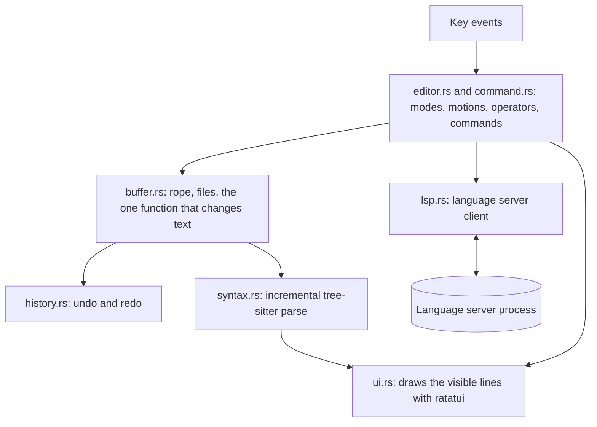

# X-EDITOR

A modal code editor for the terminal, written in Rust.

```
  1 import os
  2
  3
  4 def greet(name: str) -> str:
  5     """Return a greeting."""
  6     return "hi " + name
  7
  8
  9 value: int = greet("x")
 10 print(os.pa)  (function) def greet(name: str) -> str
 11
~                 Return a greeting.
 NORMAL  app.py                                               python  9:14
Type "str" is not assignable to declared type "int"
```

## ABOUT

The editor is called `xe`. It uses vi-style keys, highlights code with *tree-sitter*, and talks to
language servers for diagnostics, go to definition, hover and completion.

It was written to learn how editors work, so the core parts are implemented in this repository
rather than taken from a library: the text buffer, undo history, the key language, the renderer
and the language server client.

## FEATURES

- **Modal editing:** normal, insert, visual and visual-line modes, with counts, motions, operators,
  text objects and `.` repeat
- **Undo and redo:** one insert session or one command is one undo step
- **Safe saving:** files are written to a temporary file and renamed into place, so a crash while
  saving cannot truncate them
- **Syntax highlighting:** Rust, Python, JavaScript, TypeScript, JSON and C, reparsed incrementally
  on every edit
- **Search:** regular expressions with match highlighting, `*` for the word under the cursor, and
  `:s` substitution
- **Multiple buffers:** open several files and switch between them; each keeps its own cursor and
  undo history
- **Language servers:** diagnostics, go to definition, hover and completion

## GETTING STARTED

You need a recent stable Rust (install with [rustup](https://rustup.rs)) and a C compiler, which
the tree-sitter grammars are built with. It is built and tested with Rust 1.97; older versions
have not been tried.

```bash
git clone https://github.com/Iamshi-vissa/X-Editor.git
```

```bash
cd X-Editor
```

```bash
cargo run --release -- path/to/file.rs
```

To install the `xe` binary on your `PATH`:

```bash
cargo install --path .
```

Run `xe --help` for the key reference in the terminal.

## KEYS

**Moving.** A count such as `3w` or `12G` repeats any of these.

| Keys | Action |
|---|---|
| `h j k l`, arrows | Character and line |
| `w b e` | Words |
| `0 ^ $` | Line start, first non-blank, line end |
| `gg G`, `:N` | File start, file end, line N |
| `{ }` | Paragraphs |
| `%` | Matching bracket |
| `f t F T` + char, `; ,` | Find a character on the line, repeat the find |
| `Ctrl-d Ctrl-u`, `PgDn PgUp` | Half page, full page |

**Editing**

| Keys | Action |
|---|---|
| `i a I A o O` | Enter insert mode; `Esc` leaves it |
| `d c y > <` + motion | Delete, change, yank, indent, dedent |
| `dd cc yy >> <<` | The same on whole lines |
| `iw aw i( a( i[ i{ i< i" i' ` | Text objects, after an operator or in visual mode |
| `x X D C s S Y` | Character and line shortcuts |
| `r` + char, `~`, `J` | Replace character, toggle case, join lines |
| `p P` | Put after or before |
| `u`, `Ctrl-r` | Undo, redo |
| `.` | Repeat the last change |
| `v V` | Visual and visual-line selection; `o` swaps ends |

**Searching.** Patterns are regular expressions. A pattern with no capital letters ignores case.

| Keys | Action |
|---|---|
| `/text`, `?text`, `n N` | Search forward, backward, next, previous |
| `*` | Search for the word under the cursor |
| `:s/a/b/g`, `:%s/a/b/g` | Substitute on the line or in the file; `\1` and `&` work in the replacement |
| `:noh` | Hide match highlighting |

**Files and buffers**

| Keys | Action |
|---|---|
| `:w [file]`, `:wa` | Write this buffer, write all |
| `:q`, `:q!`, `:wq`, `:qa` | Quit; refuses while any buffer has unsaved changes unless `!` |
| `:e file` | Open a file in a new buffer |
| `:bn`, `:bp`, `:bd`, `:ls` | Next, previous, close, list buffers |

**Language server**

| Keys | Action |
|---|---|
| `gd`, `Ctrl-o` | Go to definition, jump back |
| `K` | Show hover information |
| `Ctrl-n` | Ask for completions; they also appear as you type |
| `Ctrl-n Ctrl-p`, `Tab` or `Enter`, `Esc` | Move in the completion list, accept, dismiss |

Diagnostics are underlined, colour the line number, and show their message on the bottom line when
the cursor is on that line.

## LANGUAGE SERVERS

Language servers are not bundled. `xe` starts one if it finds it on your `PATH` and works without
language features otherwise. Pass `--no-lsp` to never start one.

| Language | Server |
|---|---|
| Rust | `rust-analyzer` |
| Python | `pyright-langserver`, else `pylsp` |
| JavaScript, TypeScript | `typescript-language-server` |
| C | `clangd` |
| JSON | `vscode-json-language-server` |

Only `rust-analyzer` and `pyright-langserver` have been tested so far.

## HOW IT WORKS



All source files are in `src/`.

| File | Job |
|---|---|
| `buffer.rs` | Text in a rope, atomic saves, and the single function that mutates the text |
| `history.rs` | Undo and redo as grouped changes |
| `syntax.rs` | Incremental parsing and highlighting |
| `editor.rs` | Modes, counts, motions, operators, text objects, repeat and the buffer list |
| `command.rs` | The `:` command line, search and substitute |
| `lsp.rs` | JSON-RPC over the server's stdin and stdout, with one reader thread per server |
| `ui.rs` | Text, gutter, popups, status line and prompt |
| `main.rs` | Terminal setup and the event loop |

Every change to the text goes through one function in `buffer.rs`. That function also records the
change for undo and tells the syntax tree what moved, which is how those three stay in step.

`editor.rs` and `command.rs` never touch the terminal, so they are tested by feeding them keys and
checking the resulting text.

## TECH STACK

| Part | Library |
|---|---|
| Text storage | `ropey` |
| Parsing and highlighting | `tree-sitter` |
| Terminal drawing and input | `ratatui`, `crossterm` |
| Search | `regex` |
| Language server messages | `serde_json` |

## RUNNING THE TESTS

```bash
cargo test
```

There are 51 tests. One of them runs a scripted language server and needs `python3`; it skips
itself if `python3` is missing.

## STATUS

Usable for everyday editing. Not implemented:

- Split windows, named registers, macros and marks
- Ranges on `:` commands other than `%` for `:s`
- LSP rename, references, code actions, formatting and snippets
- Grapheme clusters: the cursor moves by Unicode code point, so combining marks and multi-part
  emoji count as several characters
- Files that are not UTF-8, which are refused instead of opened

## LICENSE

MIT. See [LICENSE](LICENSE).
