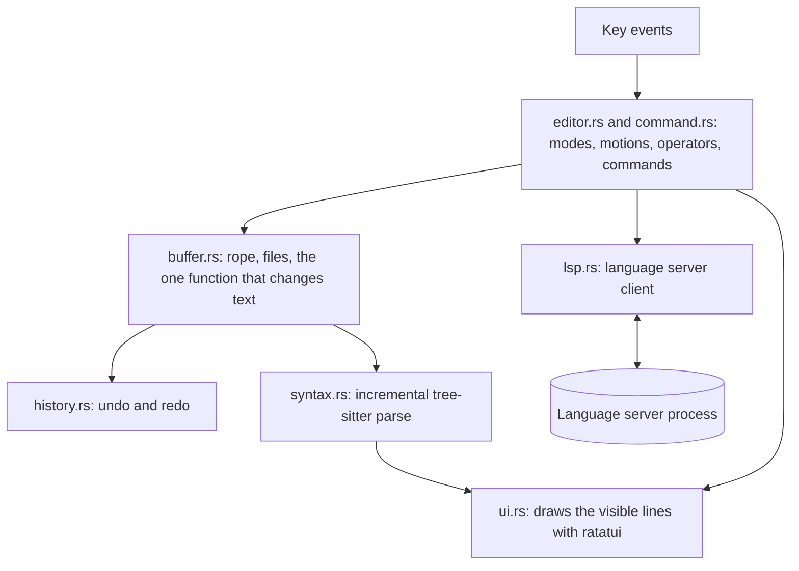

# X-EDITOR

A modal code editor for the terminal, written in Rust.

```
  1 import os
  2
  3
  4 def greet(name: str) -> str:
  5     """Return a greeting."""
  6     return "hi " + name
  7
  8
  9 value: int = greet("x")
 10 print(os.pa)  (function) def greet(name: str) -> str
 11
~                 Return a greeting.
 NORMAL  app.py                                               python  9:14
Type "str" is not assignable to declared type "int"
```

## ABOUT

The editor is called `xe`. It uses vi-style keys, highlights code with *tree-sitter*, and talks to
language servers for diagnostics, go to definition, hover and completion.

It was written to learn how editors work, so the core parts are implemented in this repository
rather than taken from a library: the text buffer, undo history, the key language, the renderer
and the language server client.

## FEATURES

- **Modal editing:** normal, insert, visual and visual-line modes, with counts, motions, operators,
  text objects and `.` repeat
- **Undo and redo:** one insert session or one command is one undo step
- **Safe saving:** files are written to a temporary file and renamed into place, so a crash while
  saving cannot truncate them
- **Syntax highlighting:** Rust, Python, JavaScript, TypeScript, JSON and C, reparsed incrementally
  on every edit
- **Search:** regular expressions with match highlighting, `*` for the word under the cursor, and
  `:s` substitution
- **Multiple buffers:** open several files and switch between them; each keeps its own cursor and
  undo history
- **Language servers:** diagnostics, go to definition, hover and completion

## GETTING STARTED

You need Rust 1.85 or newer (install with [rustup](https://rustup.rs)) and a C compiler, which the
tree-sitter grammars are built with.

```bash
git clone https://github.com/Iamshi-vissa/X-Editor.git
```

```bash
cd X-Editor
```

```bash
cargo run -p xe --release -- path/to/file.rs
```

To install the `xe` binary on your `PATH`:

```bash
cargo install --path crates/xe
```

Run `xe --help` for the key reference. The full list is in
[crates/xe/README.md](crates/xe/README.md).

## KEYS

| Keys | Action |
|---|---|
| `h j k l`, `w b e`, `0 ^ $`, `gg G` | Move by character, word, line and file |
| `f t F T` + char, `%`, `{ }` | Find on the line, matching bracket, paragraphs |
| `i a I A o O`, `Esc` | Enter and leave insert mode |
| `d c y > <` + motion | Delete, change, yank, indent, dedent |
| `iw i( i" a(` | Text objects |
| `p P`, `u`, `Ctrl-r`, `.` | Put, undo, redo, repeat |
| `v V` | Visual selection |
| `/text`, `?text`, `n N`, `*` | Search |
| `:w`, `:q`, `:wq`, `:e file`, `:bn`, `:bp` | Write, quit, open, switch buffers |
| `gd`, `Ctrl-o`, `K`, `Ctrl-n` | Go to definition, jump back, hover, complete |

## LANGUAGE SERVERS

Language servers are not bundled. `xe` starts one if it finds it on your `PATH` and works without
language features otherwise. Pass `--no-lsp` to never start one.

| Language | Server |
|---|---|
| Rust | `rust-analyzer` |
| Python | `pyright-langserver`, else `pylsp` |
| JavaScript, TypeScript | `typescript-language-server` |
| C | `clangd` |
| JSON | `vscode-json-language-server` |

Only `rust-analyzer` and `pyright-langserver` have been tested so far.

## HOW IT WORKS



| File | Job |
|---|---|
| `buffer.rs` | Text in a rope, atomic saves, and the single function that mutates the text |
| `history.rs` | Undo and redo as grouped changes |
| `syntax.rs` | Incremental parsing and highlighting |
| `editor.rs` | Modes, counts, motions, operators, text objects, repeat and the buffer list |
| `command.rs` | The `:` command line, search and substitute |
| `lsp.rs` | JSON-RPC over the server's stdin and stdout, with one reader thread per server |
| `ui.rs` | Text, gutter, popups, status line and prompt |
| `main.rs` | Terminal setup and the event loop |

Every change to the text goes through one function in `buffer.rs`. That function also records the
change for undo and tells the syntax tree what moved, which is how those three stay in step.

`editor.rs` and `command.rs` never touch the terminal, so they are tested by feeding them keys and
checking the resulting text.

## TECH STACK

| Part | Library |
|---|---|
| Text storage | `ropey` |
| Parsing and highlighting | `tree-sitter` |
| Terminal drawing and input | `ratatui`, `crossterm` |
| Search | `regex` |
| Language server messages | `serde_json` |

## RUNNING THE TESTS

```bash
cargo test -p xe
```

There are 51 tests. One of them runs a scripted language server and needs `python3`; it skips
itself if `python3` is missing.

## STATUS

Usable for everyday editing. Not implemented:

- Split windows, named registers, macros and marks
- Ranges on `:` commands other than `%` for `:s`
- LSP rename, references, code actions, formatting and snippets
- Grapheme clusters: the cursor moves by Unicode code point, so combining marks and multi-part
  emoji count as several characters
- Files that are not UTF-8, which are refused instead of opened

## DESKTOP PROTOTYPE

The repository also holds an earlier desktop prototype built with Tauri, React and Monaco, in
`apps/desktop` and the `x-core`, `x-filesystem`, `x-process` and `x-security` crates. It is not
maintained and is separate from `xe`.


Several of its panels are placeholders: toolchain installation, the extensions list and source
control do not do real work yet. To run it you need Node.js 18 or newer and, on Linux, the
WebKitGTK development packages that Tauri requires.

```bash
npm install
```

```bash
npx @tauri-apps/cli dev
```

## LICENSE

MIT. See [LICENSE](LICENSE).
