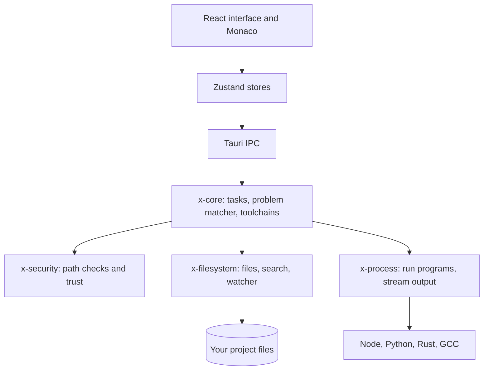

# X-EDITOR

A desktop code editor that also manages the languages and runtimes your projects need.


## ABOUT

Most editors leave runtimes to separate tools like `nvm`, `pyenv` and `rustup`. X-Editor puts them
in the same place as your code. It reads what a project expects (for example the Node version in
`package.json` or the Python version in `.python-version`), compares it with what's installed, and
can install or switch to the right version for you.

It's built with Tauri, so the interface is a React app and the heavy work (files, processes,
toolchains) runs in Rust on background threads, which keeps the editor responsive.

## XE: TERMINAL EDITOR

The repository also contains `xe`, a small modal terminal editor in Rust built on `ropey`,
`tree-sitter` and `ratatui`. It is independent of the desktop app. See
[crates/xe/README.md](crates/xe/README.md).

```bash
cargo run -p xe --release -- path/to/file.rs
```

## FEATURES

- **Editing:** *Monaco* editor (the one in VS Code), tabs, split view, breadcrumbs, minimap and
  bracket colouring
- **Command palette** (`Ctrl+Shift+P`) and quick file open (`Ctrl+P`)
- **Toolchains:** detects Node.js, Python, Rust, Go and GCC, flags version mismatches, and installs
  or activates the right version with live progress
- **Terminal:** multiple tabs with live input and output
- **Build tasks and Problems panel:** runs build and test tasks, and turns GCC, `rustc` and `tsc`
  errors into a clickable list that jumps to the right line
- **Search** across file names and file contents
- **Themes:** Purple Dark, Cyberpunk Midnight and Light Modern
- **Workspace safety:** every file path is checked so the app can't read or write outside the open
  folder, and untrusted folders can't run tasks until you *trust* them

## HOW IT WORKS

The interface sends requests to the Rust side through Tauri's *IPC*. The Rust code is split into four
small libraries:

| Crate | Job |
|---|---|
| `x-core` | Build tasks, the problem matcher and the toolchain manager |
| `x-filesystem` | Reading and writing files, search and watching for changes |
| `x-process` | Starting programs and streaming their output to the terminal |
| `x-security` | Path checks and workspace trust |

## ARCHITECTURE



The interface only asks; the Rust side does the work on background threads, and every file path goes through x-security first.

## TECH STACK

<p align="center">
  
  
  
  
  
  
  
  
</p>

| Layer | Technology |
|---|---|
| Desktop shell | Tauri v2 |
| Core | Rust (four crates) |
| Interface | React, TypeScript, Tailwind CSS v4 |
| Editor | Monaco Editor |
| State | Zustand |

## GETTING STARTED

You need:

- Node.js 18 or newer
- Rust 1.75 or newer (install with [rustup](https://rustup.rs))
- A C/C++ compiler: MinGW-w64 on Windows, Xcode Command Line Tools on macOS, or GCC/Clang on Linux
- On Linux, the WebKitGTK development packages that Tauri needs. On Debian or Ubuntu:
  `sudo apt install libwebkit2gtk-4.1-dev librsvg2-dev libayatana-appindicator3-dev`

Then:

```bash
git clone https://github.com/Iamshi-vissa/X-Editor.git
cd X-Editor
npm install
npx @tauri-apps/cli dev
```

On Windows with MSYS2, put MinGW on your path first (PowerShell):

```powershell
$env:PATH = "C:\msys64\mingw64\bin;" + $env:PATH
$env:WINDRES = "C:\msys64\mingw64\bin\windres.exe"
npx @tauri-apps/cli dev
```

## RUNNING THE TESTS

```bash
cargo test -p x-core -p x-security -p x-process -p x-filesystem   # 21 tests
cd apps/desktop/frontend && npx tsc --noEmit && npm run build
```

## PROJECT STRUCTURE

```
apps/desktop/frontend/    React interface
apps/desktop/src-tauri/   Tauri app and the commands the interface calls
crates/                   the four Rust libraries
packages/                 shared TypeScript types and design tokens
docs/assets/              screenshots
```

## STATUS

In progress. Editing, toolchains, the terminal, tasks, the *Problems panel* and search all work.

Not finished yet:

- **Source control:** the Git panel is a design mockup. It shows sample changes, and the commit
  button doesn't run Git yet.
- **Extensions:** the marketplace panel shows a fixed sample list and can't install anything.

## LICENSE

MIT. See [LICENSE](LICENSE).
