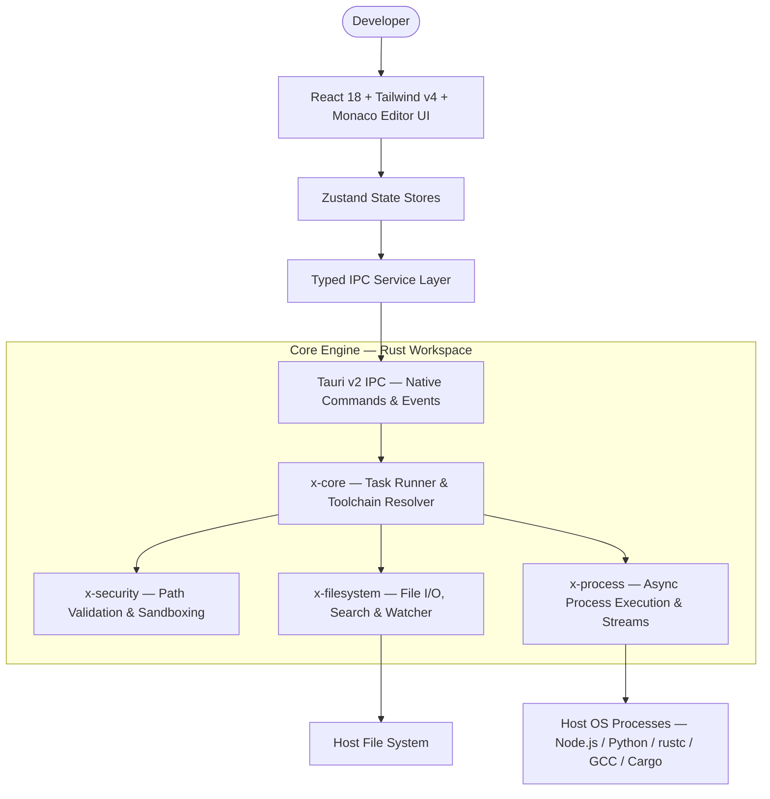

# X-Editor

**A High-Performance, Local-First Desktop IDE with Integrated Toolchain Management**

[](LICENSE)
[](https://www.rust-lang.org/)
[](https://react.dev/)
[](https://tauri.app/)


---

## Overview

X-Editor is a local-first code editor engineered for execution speed, deep toolchain control, and zero-latency code navigation. It combines a React 18 / TypeScript / Tailwind CSS v4 / Monaco Editor frontend with a multi-crate Rust core, connected through Tauri v2 IPC, to deliver a workstation-class desktop IDE with native runtime management built in.

Conventional editors treat runtime management as an external concern, requiring developers to coordinate separate CLI tools (`nvm`, `pyenv`, `rustup`) alongside their editor. X-Editor removes that separation by unifying code editing and runtime lifecycle management within a single native application.

### Design Goals

| Goal | Implementation |
|---|---|
| **Local-first security** | Sandboxed file access validation via the `x-security` crate, preventing unauthorized disk access |
| **Non-blocking I/O** | Terminal streaming, file watching, and compiler processes run on background OS threads (`x-process`, `x-filesystem`), preserving a 60fps UI loop |
| **Active environment resolution** | Continuous validation of project manifests (`package.json` engines, `.python-version`, `Cargo.toml`) against installed system runtimes, with one-click remediation |

---

## Feature Guide

### 1. Theming — Black & Violet Design System

A custom design token schema (`themeTokens.ts`) drives the editor's visual language:

| Element | Color | Value |
|---|---|---|
| Editor background | Deep obsidian | `#0e0e14` |
| Sidebar / surface panels | Low-contrast dark violet | `#141019` |
| Primary accent | Signature violet | `#8b5cf6` |
| Keywords | | `#a855f7` |
| Strings | | `#c4b5fd` |
| Functions | | `#d8b4fe` |
| Types / classes | | `#e9d5ff` |
| Comments | | `#7a7590` |
| Numbers | | `#c084fc` |
| Variables | | `#e4e0f0` |

Switch themes via the **Palette** icon in the Activity Bar, which opens the Color Theme Picker with **Purple Dark**, **Cyberpunk Midnight**, and **Light Modern** presets.

### 2. Multi-Pane Editing & Navigation

- **Split Editor View** (`Ctrl+\`) — dual side-by-side Monaco instances for simultaneous multi-file editing
- **Tab management** — pinned tabs, dirty-state indicators (`•`), close-on-hover
- **Breadcrumb navigation** — interactive file path hierarchy below the tab bar
- **Minimap & bracket-pair colorization** — real-time structural visualization along the editor's right edge

### 3. Command Palette & Quick Open

- **Command Palette** (`Ctrl+Shift+P` / `F1`) — fuzzy search across IDE commands, build tasks, toolchain detections, and preferences
- **Quick Open** (`Ctrl+P`) — instant file navigation by workspace path

### 4. Toolchain Management Engine

- **Runtime discovery** — automatic detection of installed compilers and runtimes (Node.js, Python, Rust via `cargo`/`rustc`, Go, GCC/MinGW)
- **Version mismatch resolution** — flags discrepancies between project manifests and active toolchains
- **One-click fix** — activates the required runtime version and writes a synchronized `.toolchain.json` to the workspace root
- **Toolchain logs panel** — streams installation, compilation, and sync logs to the bottom drawer

### 5. Integrated Terminal & Development Panels

- **Multi-tab terminal** (`` Ctrl+` ``) — embedded PowerShell/CMD sessions with interactive stdin/stdout streaming
- **Compiler problem matcher** — parses GCC, `rustc`, and `tsc` output into the Problems panel; clicking an entry jumps the editor to the exact line and column
- **Source control (Git)** — branch status, staged/unstaged diffs, and inline commit/push
- **Extensions marketplace** — manage development extensions (Rust Analyzer, C/C++ IntelliSense, Python, Tailwind CSS)

---

## System Architecture



**State layer:** `DocumentStore`, `TaskStore`, `ToolchainStore`, `WorkspaceStore`, `TerminalStore` (Zustand)

---

## Repository Structure

```
.
├── apps/
│   └── desktop/
│       ├── frontend/          # React 18, TypeScript, Tailwind CSS v4, Monaco Editor UI
│       └── src-tauri/         # Tauri v2 entry point & Rust IPC command handlers
├── crates/
│   ├── x-core/                # Task runner, problem matcher, toolchain engine
│   ├── x-filesystem/          # File operations, recursive search, file watcher
│   ├── x-process/             # Async process execution & stdout/stderr streaming
│   └── x-security/            # Workspace trust policies & path validation sandbox
├── .toolchain.json            # Project toolchain environment configuration
├── .x-editor/                 # Workspace-specific task and editor settings
└── Cargo.toml                 # Workspace Cargo manifest
```

---

## Getting Started

### Prerequisites

| Requirement | Version |
|---|---|
| Operating System | Windows 10/11, macOS, or Linux |
| Node.js | ≥ 18.0.0 |
| Rust toolchain | `cargo` ≥ 1.75 |
| C/C++ compiler | MinGW-w64 (Windows) or Clang |

### Installation

```bash
git clone https://github.com/Iamshi-vissa/X-Editor.git
cd X-Editor
npm install
```

### Running in Development Mode

**Windows (PowerShell):**

```powershell
$env:PATH = "C:\msys64\mingw64\bin;" + $env:PATH
$env:WINDRES = "C:\msys64\mingw64\bin\windres.exe"
npx @tauri-apps/cli dev
```

**macOS / Linux:**

```bash
npx @tauri-apps/cli dev
```

---

## Testing

Run the unit test suite across all core Rust crates:

```bash
cargo test -p x-core -p x-security -p x-process -p x-filesystem
```

---

## License

Distributed under the MIT License. See [LICENSE](LICENSE) for full details.