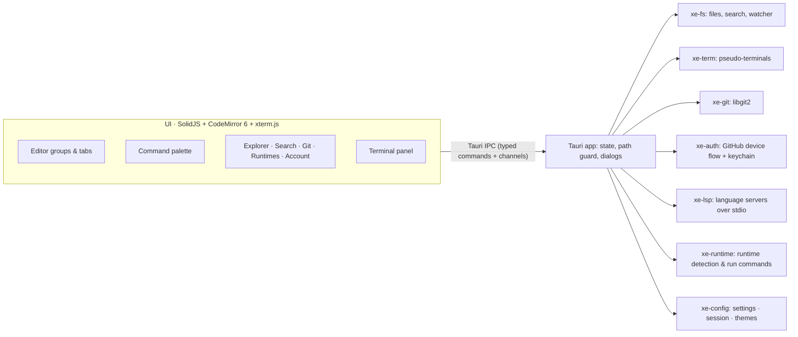

# X-EDITOR

**Write in Flow. Build in Studio.** A fast, good-looking code editor that grows into an IDE when
you need one, and gets out of the way when you don't.


## WHY X-EDITOR

Most editors make you choose: a light text editor that can't run or debug your project, or a
heavy IDE that takes seconds to open and gigabytes of memory. X-Editor is both, with one key
press between them.

| | **Flow mode** | **Studio mode** |
|---|---|---|
| For | Writing, reading, reviewing, notes | Building, running, debugging, shipping |
| You see | A centred, distraction-free editor | Explorer, search, Git, runtimes, terminal |
| Switch | `Ctrl/Cmd+Alt+M` or click the mode pill | Same |


### What it fixes compared with other editors

- **Speed without trade-offs.** Rust does the heavy work (file search, Git, terminals, file
  watching) on background threads. The UI is SolidJS, which has no virtual DOM, and
  CodeMirror 6, which only renders what's on screen. Installers are around 10 MB, not 150 MB.
- **Runtimes are first-class.** X-Editor reads what a project asks for (`.nvmrc`,
  `.python-version`, `rust-toolchain.toml`, `go.mod`, `.tool-versions`, `mise.toml`, `engines`
  in `package.json`, `requires-python`), compares it with what's installed, and tells you
  when they don't match.
- **Run anything with F5.** It compiles into a temp folder (never next to your source), quotes
  paths correctly for bash, zsh and PowerShell, and runs the result in a real terminal.
  `Shift+F5` runs the whole project (Cargo, npm/pnpm/yarn/bun scripts, Go, Django, Maven,
  Gradle, .NET, Make).
- **Customisable all the way down.** Five themes plus your own JSON themes, any accent colour,
  density, corner roundness, fonts, ligatures, line numbers, autosave, and every shortcut is
  rebindable. Changes apply instantly, with no reload.
- **Nothing fake.** Every panel does what it says. No placeholder buttons, no mock data.
- **Safe by default.** File access is restricted to the open folder and files you pick in a
  native dialog. Saves are atomic, so a crash never leaves a half-written file. Deletes go to the
  system trash, and your GitHub token lives in the OS keychain.

## FEATURES

**Editing.** CodeMirror 6 with multi-cursor, rectangular selection, bracket matching,
auto-close, folding, indent guides, find and replace with regex, a smooth caret, relative line
numbers, and syntax highlighting for 100+ languages loaded on demand. Every tab keeps a live
editor, so undo history and scroll position survive tab switches. Split view with drag-and-drop
tabs, breadcrumbs, and Markdown live preview.

**Code intelligence (LSP).** Autocomplete, hover docs, signature help, go to definition, find
references, rename, formatting and inline errors, from the language servers you already use:
`typescript-language-server`, `rust-analyzer`, `pyright`, `clangd` and `gopls` out of the box,
and any other server through settings. Missing servers come with a one-click install command.

**Terminal.** Real pseudo-terminals (ConPTY on Windows), so colours, prompts, Ctrl+C, `vim`,
`htop` and interactive programs all work. Multiple tabs, GPU rendering, and clickable links.

**Git.** Status, stage, unstage, discard (to the trash), commit, push, pull, fetch, branch
switch and create, side-by-side diffs, and change markers in the gutter as you type. Pulls
only fast-forward, so nothing is merged behind your back.


**GitHub.** Sign in with GitHub using the device flow (no password ever touches the app),
browse your repositories, and clone them in one click. Push and pull use your account
automatically.

**Navigation.** One palette for everything: `Ctrl/Cmd+P` finds files with fuzzy matching, `>`
runs any command, `:` jumps to a line. Workspace search runs in parallel, respects
`.gitignore`, and replaces across files.

**Comfort.** Your session restores per folder (open tabs, layout, mode). Optional autosave.
Files changed on disk reload automatically, or you're asked if you have unsaved edits. Trailing
whitespace and final newlines are handled on save, CRLF line endings are preserved, and zoom
works.


## HOW IT WORKS



The interface never touches the disk or network directly. It asks the Rust side through typed
commands, and every path is checked against the open folder before anything is read or
written. Terminal output and language-server messages stream over Tauri channels, so even fast
output stays smooth.

| Crate | Job |
|---|---|
| `xe-fs` | Path guard, atomic saves, trash deletes, `.gitignore`-aware listing and parallel search, file watcher |
| `xe-term` | Pseudo-terminal sessions with UTF-8-safe streaming |
| `xe-git` | libgit2 status, staging, commits, branches, gutter diffs, clone / fetch / pull / push |
| `xe-auth` | GitHub OAuth device flow, user and repository API, keychain storage |
| `xe-lsp` | Spawns language servers and relays JSON-RPC messages |
| `xe-runtime` | Detects installed runtimes, reads project version files, builds run commands |
| `xe-config` | `settings.json`, session state and custom themes on disk |

## TECH STACK

| Layer | Technology | Why |
|---|---|---|
| Desktop shell | **Tauri 2** | Native webview, small installers, low memory |
| Core | **Rust** (7 crates) | Speed, safety, real threads |
| UI | **SolidJS** + TypeScript | Fine-grained reactivity with no virtual DOM |
| Editor | **CodeMirror 6** | Modular, fast with huge files, fully themeable, official LSP client |
| Terminal | **xterm.js** + `portable-pty` | The same terminal stack VS Code uses |
| Git | **libgit2** (`git2`) | Works without Git installed |
| Fonts | Inter, JetBrains Mono (bundled) | Crisp UI and ligature-friendly code |

## GETTING STARTED

You need **Node.js 20+** and **Rust 1.80+** ([rustup](https://rustup.rs)). On Linux, you also
need the WebKitGTK libraries:

```bash
sudo apt install libwebkit2gtk-4.1-dev librsvg2-dev libayatana-appindicator3-dev libdbus-1-dev
```

Then:

```bash
git clone https://github.com/Iamshi-vissa/X-Editor.git
cd X-Editor
npm install
npm run dev
```

`npm run build` produces installers for your platform in `target/release/bundle/`.

To enable **Sign in with GitHub**, follow [docs/GITHUB_LOGIN.md](docs/GITHUB_LOGIN.md) (it takes
about two minutes). For signed releases on every platform, see [docs/RELEASING.md](docs/RELEASING.md).

## CUSTOMISING

- **Settings:** `Ctrl/Cmd+,` opens the visual editor, and "Edit settings.json" opens the raw
  file, which supports `//` comments.
- **Shortcuts:** `Ctrl/Cmd+K` lists every command. Click one and press the new keys.
- **Themes:** see [docs/THEMES.md](docs/THEMES.md) to make your own.
- **Language servers:** add any server under `"lsp.servers"` in `settings.json`.

## CHECKS

```bash
npm run check
```

This runs the TypeScript type-check, Clippy and the Rust tests. CI runs the same checks on
Windows, macOS and Linux for every push.

## ROADMAP

See [docs/ROADMAP.md](docs/ROADMAP.md): debugger (DAP), extension API, AI assistance,
real-time collaboration, remote development and more.

## LICENSE

[MIT](LICENSE) © 2026 Vamshi Bharath
