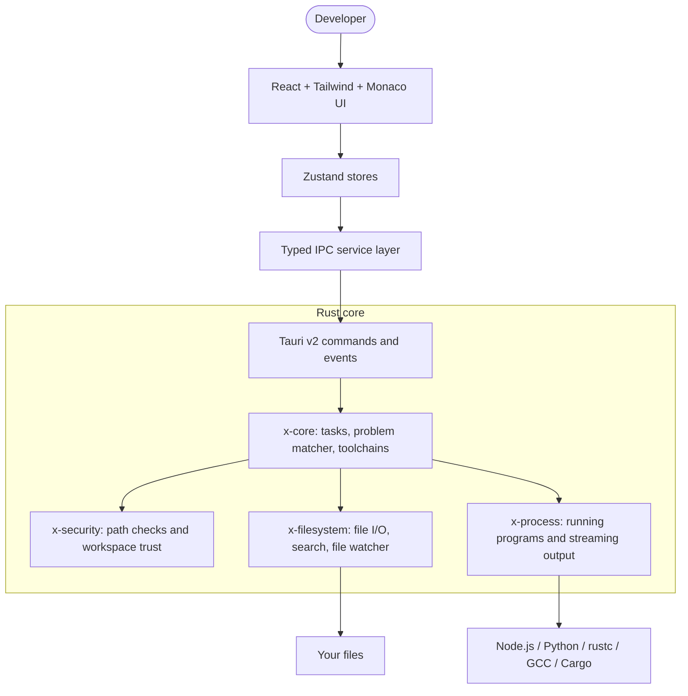

# X-Editor

**A fast, local-first desktop code editor with built-in toolchain management.**

[](https://www.rust-lang.org/)
[](https://react.dev/)
[](https://tauri.app/)


## About

X-Editor is a desktop code editor that also manages the compilers and runtimes your project
needs. Most editors leave that to separate tools such as `rustup` or `nvm`. X-Editor detects the
C/C++ compilers, Rust and Node.js installed on your machine, checks them against what the project
asks for, and offers a one-click fix when they don't match.

The interface is built with React and the Monaco editor (the editor inside VS Code). Everything
that touches your disk or runs programs is written in Rust, runs on background threads so the
interface stays smooth, and only works inside the folder you opened.

## Features

### Working today

- **Editing:** Monaco editor with tabs, split view (`Ctrl+\`), breadcrumbs, minimap and
  bracket-pair colours.
- **Command palette and quick open:** `Ctrl+Shift+P` / `F1` for commands, `Ctrl+P` to jump to a file.
- **Toolchain manager:** detects GCC/MinGW, Clang/LLVM, Rust (rustup) and Node.js; flags version
  mismatches with your project; installs or switches versions and writes a `.toolchain.json` to
  the workspace.
- **Integrated terminal** (`` Ctrl+` ``): multiple terminal tabs with live output and input.
- **Tasks and problems:** build, test and clean tasks are set up automatically for Cargo and C++
  projects; compiler errors from GCC, `rustc` and `tsc` appear in the Problems panel, and clicking
  one jumps to the line.
- **Search:** search across all files in the workspace.
- **Themes:** Purple Dark (default), Cyberpunk Midnight and Light Modern.
- **Workspace sandbox:** every file operation is checked so it can't reach outside the open folder.

### Not finished yet

- **Source control panel:** the layout is built, but it shows sample data. Real Git status,
  staging, commit and push are not connected yet.
- **Extensions panel:** shows a sample list. Installing and running extensions is not implemented.
- **More languages:** Python and Go are not detected by the toolchain manager yet.
- **Shared packages:** `packages/shared-types` and `packages/ui-tokens` only contain a
  `package.json` so far; the types and tokens still live inside the frontend.

## Tech stack

| Part | Tools |
|---|---|
| Interface | React 18, TypeScript, Tailwind CSS v4, Monaco Editor, Zustand |
| Desktop shell | Tauri v2 (typed IPC commands and events) |
| Core engine | Rust workspace: `x-core`, `x-filesystem`, `x-process`, `x-security` (Tokio, notify) |
| Tooling | Cargo, npm workspaces, Vite, oxlint, clippy, rustfmt |

## How it works



## Getting started

### Prerequisites

| Requirement | Version |
|---|---|
| Operating system | Windows 10/11, macOS or Linux |
| Node.js | 18 or newer |
| Rust | 1.75 or newer (`rustup`) |
| C/C++ compiler | MinGW-w64 on Windows, Xcode Command Line Tools on macOS, GCC/Clang on Linux |
| Linux only | Tauri's system libraries (WebKitGTK and friends): see the [Tauri prerequisites](https://tauri.app/start/prerequisites/) |

### Install and run

```bash
git clone https://github.com/Iamshi-vissa/X-Editor.git
cd X-Editor
npm install
npx @tauri-apps/cli dev
```

On Windows with MSYS2, put MinGW on the `PATH` first (the path to `windres.exe` is also set in
`.cargo/config.toml`; change it if MSYS2 is installed somewhere else):

```powershell
$env:PATH = "C:\msys64\mingw64\bin;" + $env:PATH
$env:WINDRES = "C:\msys64\mingw64\bin\windres.exe"
npx @tauri-apps/cli dev
```

### Build an installer

```bash
npx @tauri-apps/cli build
```

## Running the tests

```bash
cargo test -p x-core -p x-security -p x-process -p x-filesystem   # Rust core (21 tests)
cargo fmt --all --check && cargo clippy -p x-core -p x-security -p x-process -p x-filesystem

cd apps/desktop/frontend
npx tsc -b && npm run lint && npm run build                        # interface
```

## Project structure

```
apps/desktop/frontend/   React interface (components, Zustand stores, IPC client)
apps/desktop/src-tauri/  Tauri entry point and the IPC command handlers
crates/x-core/           task runner, problem matcher, toolchain engine
crates/x-filesystem/     file operations, search, file watcher
crates/x-process/        running programs and streaming their output
crates/x-security/       workspace trust and path validation
packages/shared-types/   placeholder for shared TypeScript types (not filled in yet)
packages/ui-tokens/      placeholder for design tokens (not filled in yet)
docs/assets/             screenshots
```

## Status

The editor, toolchain manager, terminal, tasks and problem matcher work. Next steps:

- Connect the Source control panel to real Git.
- Build the extension system behind the Extensions panel.
- Add Python and Go to the toolchain manager.
- Add tests for the frontend and the Tauri command layer (today only the Rust crates are tested).
- Add CI to run the tests and linters on every push.

## License

No license has been added yet, so all rights are reserved by default.
